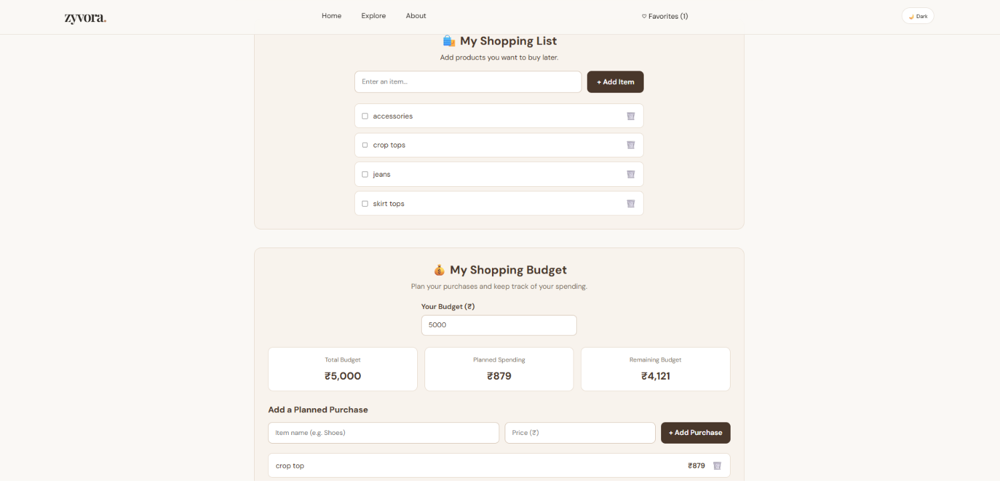
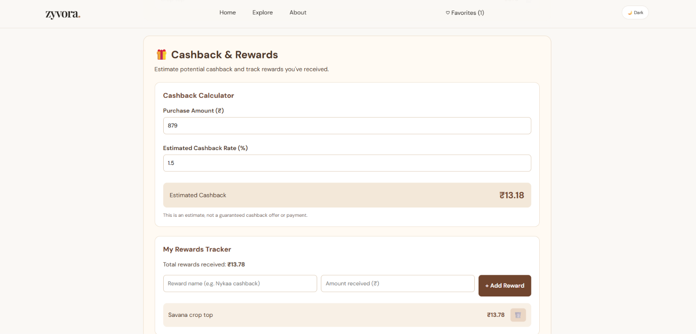

# 🛍️ Zyvora — Smart Shopping Discovery Platform

Zyvora is a shopping discovery platform that brings popular fashion
and beauty shopping websites together in one place. It helps users
explore platforms, organize shopping lists, plan budgets, and track
estimated cashback and rewards.

🌐 **Live Website:** https://zyvora-kappa.vercel.app/
## 📸 Screenshots

### 🏠 Homepage


### 🛍️ Shopping List and Budget Planner


### 🎁 Cashback and Rewards

---

## ✨ Features

- 🛒 **Shopping Discovery:** Access multiple fashion and beauty platforms.
- ❤️ **Favorites:** Save your preferred shopping platforms.
- 🌙 **Dark Mode:** Switch between light and dark themes.
- 🕘 **Recently Visited:** Keep track of recently visited platforms.
- 📝 **Shopping List:** Add, manage, and remove shopping items.
- 💰 **Budget Planner:** Plan purchases and monitor your remaining budget.
- 🎁 **Cashback Calculator:** Estimate cashback based on a percentage.
- 🏆 **Rewards Tracker:** Record and manage rewards.

## 🛠️ Technologies Used

- React
- JavaScript
- Vite
- CSS
- HTML
- Browser Local Storage
- Git and GitHub
- Vercel

## 🖥️ Supported Shopping Platforms

- Myntra
- AJIO
- H&M
- Nykaa
- Purplle
- Savana

## 🚀 Run Locally

### Prerequisites

Install Node.js and Git.

### Installation

1. Clone the repository:

   ```bash
   git clone https://github.com/NivedithaKCyber/Zyvora.git
